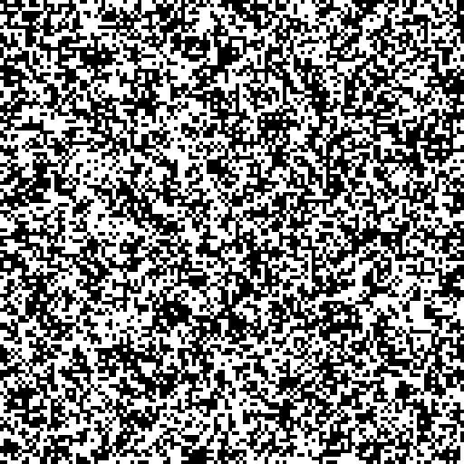
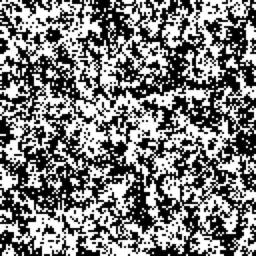
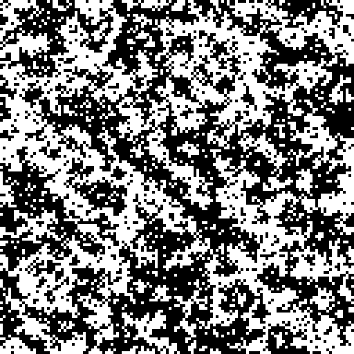

# 2D Ising Model Monte Carlo Simulator

C implementation of the **2D Ising Model** with periodic boundary conditions using the **Metropolis-Hastings** algorithm, extended with **OpenMP parallel beta sweeps**, **inverse-logistic $\beta$ sampling** around the critical point ($\beta_c \approx 0.4407$), **hysteresis loops**, and Python/LaTeX visualization scripts.

## Thermalization ($L = 128$)

| Disordered ($\beta = 0.200 < \beta_c$) | Critical ($\beta = 0.441 \approx \beta_c$) | Ordered ($\beta = 0.700 > \beta_c$) |
| :---: | :---: | :---: |
|  |  |  |

## Features

- **Metropolis-Hastings core (`metropolis.c`, `observables.c`)**: Precomputed transition probability table and neighbor index vectors for periodic boundaries; measures energy, specific heat ($C_v$), absolute magnetization ($\langle |M| \rangle$), and susceptibility ($\chi$) using the Parisi-Rapuano RNG (`random.c`).
- **OpenMP parallel sweeps (`ising_parallel_thread.c`)**: Runs independent $\beta$ values across CPU cores and concentrates ~76% of samples around $\beta_c = \frac{\ln(1+\sqrt{2})}{2} \approx 0.44068679$ via an inverse-logistic mapping.
- **Hysteresis (`hysteresis.c`, `hysteresis_ilaky.c`, `graph_hysteresis.py`)**: Sweeps $\beta$ up and down and plots multi-run averages with standard error bars.
- **Visualization (`gif_creator.py`, `figures/`)**: Builds thermalization GIFs from raw `int8` spin streams, plus LaTeX/PDF figures (`megaPlot3D.pdf`, `nubesBeta.pdf`, `logistic.pdf`, `distrFunc.pdf`) in [`figures/`](figures/).

## Structure

```text
├── ising.h                     # Structs (Parameters, Lattice) and prototypes
├── ising.c                     # Sequential simulation driver
├── ising_parallel_thread.c     # OpenMP parallel beta-sweep & logistic sampling
├── metropolis.c                # Metropolis update & observable measurement
├── observables.c               # Energy, magnetization, periodic direction vectors
├── analysis.c                  # Mean, variance, and histogram utilities
├── hysteresis.c / hysteresis_ilaky.c
├── utils.c / io.c / memory.c / random.c
├── gif_creator.py              # Binary spin stream -> GIFs
├── graph_hysteresis.py         # Multi-run hysteresis plotting
├── python_converter.py         # Merges multi-L simulation files
├── final_results/              # Combined dataset (L = 16..128 across 6 PCs)
├── figures/                    # LaTeX/PDF phase transition & sampling plots
├── assets/                     # L=128 thermalization GIFs
└── Makefile
```

## Build & Run

Requires `gcc` (with `-fopenmp`) and `make` (or `mingw32-make` on Windows). Python scripts require `numpy`, `matplotlib`, `pandas`, `tqdm`, and `pillow`.

```bash
# Build sequential and OpenMP binaries
make

# Run OpenMP parallel sweep (writes to results/simulations_Lxxx.txt)
./ising_parallel

# Run sequential version
./ising

# Optional debug binaries for individual modules
make debug
```

## Credits & License

Originally built as a Computational Physics group project (`computacional-unizar`) at the University of Zaragoza, with OpenMP parallelization, critical-region logistic sampling, hysteresis sweeps, and animation scripts refactored here as a standalone repository.

Licensed under the [MIT License](LICENSE).
